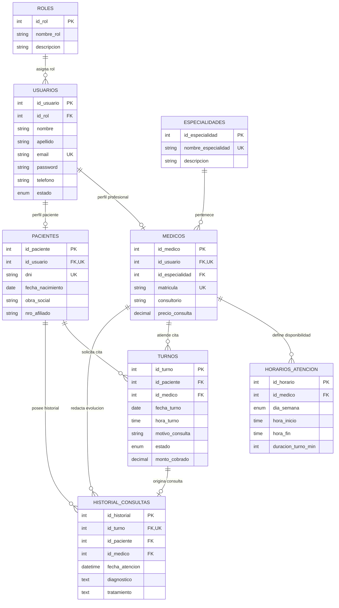

# 🏥 Sistema de Gestión y Reservas Clínicas

Sistema integral para la administración, programación de turnos y atención médica ambulatoria, diseñado bajo el patrón arquitectónico **MVC (Modelo - Vista - Controlador)** en **PHP** con base de datos relacional normalizada en **MySQL / MariaDB (XAMPP)** para la materia **Base de Datos 2**.

---

## 📑 Tabla de Contenidos
1. [Descripción General](#-descripción-general)
2. [Entidades y Atributos (Modelo de Datos)](#-entidades-y-atributos)
3. [Actores del Sistema](#-actores-del-sistema)
4. [Interacciones y Relaciones](#-interacciones-y-relaciones)
5. [Alcance y Limitaciones](#-alcance-y-limitaciones)
6. [Diagrama Entidad-Relación (DER)](#-diagrama-entidad-relación-der)
7. [Arquitectura del Software (Patrón MVC)](#-arquitectura-del-software-patrón-mvc)
8. [Elementos Avanzados de Base de Datos 2](#-elementos-avanzados-de-base-de-datos-2)
9. [Estructura del Proyecto](#-estructura-del-proyecto)
10. [Instalación y Configuración Local](#-instalación-y-configuración-local)

---

## 📖 Descripción General

El **Sistema de Reservas Clínicas** es una solución digital diseñada para resolver la sobrecarga administrativa y la ineficiencia en la asignación de turnos médicos en centros de salud y policlínicos. Su objetivo es optimizar los tiempos de espera, erradicar errores de sobreturnos, y mejorar la experiencia tanto de los pacientes como del personal médico y de recepción.

El sistema se estructura sobre una base de datos relacional normalizada en **Tercera Forma Normal (3FN)** con motor **InnoDB**, garantizando consistencia, integridad referencial y alto rendimiento en las operaciones transaccionales.

---

## 🗃️ Entidades y Atributos

El sistema cuenta con **8 tablas principales normalizadas**:

### 1. `roles`
* `id_rol` (**PK**): Identificador único del rol (1: Admin, 2: Médico, 3: Recepción, 4: Paciente).
* `nombre_rol`: Denominación del rol.
* `descripcion`: Permisos y alcance del rol.

### 2. `usuarios`
* `id_usuario` (**PK**): Identificador único del usuario.
* `id_rol` (**FK**): Rol asignado (`roles.id_rol`).
* `nombre`, `apellido`: Datos personales.
* `email` (**UK**): Correo institucional / personal único.
* `password`: Hash seguro de contraseña (`password_hash`).
* `telefono`: Número de contacto.
* `estado`: Estado de la cuenta (`ACTIVO`, `INACTIVO`).
* `fecha_registro`: Fecha y hora de alta.

### 3. `especialidades`
* `id_especialidad` (**PK**): Identificador de la especialidad.
* `nombre_especialidad` (**UK**): Nombre de la rama médica (Cardiología, Pediatría, Traumatología, etc.).
* `descripcion`: Detalle de la especialidad.
* `estado`: Activa / Inactiva.

### 4. `medicos`
* `id_medico` (**PK**): Identificador del profesional.
* `id_usuario` (**FK, UK**): Usuario asociado (`usuarios.id_usuario`).
* `id_especialidad` (**FK**): Especialidad médica ejercida (`especialidades.id_especialidad`).
* `matricula` (**UK**): Matrícula médica profesional única.
* `consultorio`: Número o código de consultorio físico.
* `precio_consulta`: Arancel base de la consulta.

### 5. `pacientes`
* `id_paciente` (**PK**): Identificador del paciente.
* `id_usuario` (**FK, UK**): Usuario asociado (`usuarios.id_usuario`).
* `dni` (**UK**): Documento Nacional de Identidad único.
* `fecha_nacimiento`: Fecha de nacimiento.
* `obra_social`: Cobertura médica o seguro de salud.
* `nro_afiliado`: Número de credencial de afiliado.
* `direccion`: Domicilio particular.

### 6. `horarios_atencion`
* `id_horario` (**PK**): Identificador de la disponibilidad.
* `id_medico` (**FK**): Profesional asignado (`medicos.id_medico`).
* `dia_semana`: Día de atención (`LUNES`, `MARTES`, etc.).
* `hora_inicio`, `hora_fin`: Franja horaria de atención.
* `duracion_turno_min`: Duración de cada consulta en minutos (ej. 30 min).

### 7. `turnos`
* `id_turno` (**PK**): Identificador único de la cita médica.
* `id_paciente` (**FK**): Paciente solicitante (`pacientes.id_paciente`).
* `id_medico` (**FK**): Médico tratante (`medicos.id_medico`).
* `fecha_turno`, `hora_turno`: Fecha y horario de la cita (**Índice Único Compuesto** `(id_medico, fecha_turno, hora_turno)` que impide sobreturnos).
* `motivo_consulta`: Motivo de la visita médica.
* `estado`: Estado (`PENDIENTE`, `CONFIRMADO`, `EN_ESPERA`, `ATENDIDO`, `CANCELADO`, `AUSENTE`).
* `monto_cobrado`: Valor cobrado o copago.

### 8. `historial_consultas`
* `id_historial` (**PK**): Identificador de la ficha de atención.
* `id_turno` (**FK, UK**): Turno que dio origen a la atención (`turnos.id_turno`).
* `id_paciente` (**FK**), `id_medico` (**FK**): Paciente y profesional involucrados.
* `fecha_atencion`: Fecha y hora de realización.
* `diagnostico`: Diagnóstico médico emitido.
* `tratamiento`: Recetas, indicaciones y prescripciones.
* `observaciones`: Notas clínicas adicionales.

---

## 👥 Actores del Sistema

| Actor | Funciones y Permisos Principales |
| :--- | :--- |
| **Paciente** | Busca médicos por especialidad, consulta disponibilidad en tiempo real, reserva turnos, visualiza comprobantes y cancela/reprograma citas. |
| **Médico** | Consulta su agenda diaria/semanal, registra asistencia de pacientes, y carga diagnósticos y recetas en el historial de consulta. |
| **Recepcionista** | Gestiona turnos presenciales y telefónicos, recepciona pacientes en sala de espera, valida obras sociales y cobra copagos. |
| **Administrador** | Administra usuarios, médicos y especialidades, audita la base de datos y genera reportes de ausentismo y demanda médica. |

---

## 🔄 Interacciones y Relaciones

1. **Reserva Inteligente (AJAX):** El paciente elige la especialidad $\rightarrow$ se filtran los médicos correspondientes $\rightarrow$ selecciona una fecha $\rightarrow$ el sistema calcula y muestra solo las franjas horarias libres basadas en `horarios_atencion` y los turnos existentes.
2. **Control Anti-Colisión:** La base de datos rechaza automáticamente mediante índice único cualquier intento de reservar al mismo médico en la misma fecha y hora.
3. **Ciclo de Atención:** Al pasar un turno a estado `ATENDIDO`, el médico registra el diagnóstico en `historial_consultas`, activando el trigger de actualización de estado.

---

## 🎯 Alcance y Limitaciones

### Alcance
* Gestión integral del ciclo de vida del turno médico ambulatorio.
* Control de agendas, días festivos y franjas horarias por profesional.
* Ficha clínica histórica por paciente.
* Panel de administración con métricas y reportes de atención.

### Limitaciones
* No incluye integración en tiempo real con equipos de diagnóstico por imágenes (PACS/DICOM).
* No incluye módulos de internación, terapia intensiva ni quirófanos de alta complejidad.
* Los pagos en línea automáticos quedan reservados para una siguiente fase (el registro actual es por recepción).

---

## 📊 Diagrama Entidad-Relación (DER)



---

## 🏛️ Arquitectura del Software (Patrón MVC)

* **Controladores (`app/Controllers/`):** Reciben las peticiones HTTP, validan los datos y llaman a los modelos correspondientes.
* **Modelos (`app/Models/`):** Gestionan las consultas SQL a través de la capa de conexión PDO (`Database.php`), aplicando sentencias preparadas contra inyecciones SQL.
* **Vistas (`app/Views/`):** Interfaz gráfica renderizada con Bootstrap 5, componentes dinámicos y modales interactivos.
* **Enrutador Front-Controller (`public/index.php` + `app/Core/Router.php`):** Centraliza y enruta limpiamente las URLs del sistema.

---

## ⚙️ Elementos Avanzados de Base de Datos 2

1. **Restricción de Unicidad (Anti-Sobreturnos):**
   ```sql
   ALTER TABLE turnos ADD UNIQUE INDEX uk_medico_fecha_hora (id_medico, fecha_turno, hora_turno);
   ```
2. **Vistas SQL (`Views`):**
   * `vw_turnos_detallados`: Listado completo uniendo turnos con pacientes, médicos, consultorios y especialidades.
3. **Procedimiento Almacenado con Control Transaccional:**
   * `sp_reservar_turno`: Valida disponibilidad y ejecuta `START TRANSACTION`, `COMMIT` o `ROLLBACK` ante errores.
4. **Trigger de Automatización:**
   * `trg_actualizar_estado_turno`: Actualiza el turno a `'ATENDIDO'` de forma automática cuando se guarda la ficha en `historial_consultas`.

---

## 📁 Estructura del Proyecto

```text
sistema-de-reservas-clinicas/
├── app/
│   ├── Controllers/     # Controladores (Auth, Turnos, Médicos, etc.)
│   ├── Core/            # Router, Controller base, Model base
│   ├── Models/          # Modelos de datos (PDO)
│   └── Views/           # Vistas PHP y plantillas HTML
├── config/
│   ├── config.php       # Constantes y configuración global
│   └── Database.php     # Conexión Singleton PDO
├── database/
│   ├── schema.sql       # Creación de tablas, PK, FK e índices
│   └── procedures.sql   # Vistas, Triggers y Procedimientos Almacenados
├── public/
│   ├── assets/          # CSS, JS, imágenes
│   ├── index.php        # Front Controller
│   └── .htaccess        # Reglas de reescritura de URL
├── TRABAJO_SISTEMA_RESERVAS_CLINICAS.md  # Documento descriptivo y DER
├── implementation_plan.md               # Plan técnico detallado
└── README.md                            # Documentación principal del repositorio
```

---

## 🚀 Instalación y Configuración Local

1. **Clonar o descargar el repositorio:**
   Ubicar la carpeta en el directorio `htdocs` de XAMPP:
   ```bash
   C:\xampp\htdocs\sistema-de-reservas-clinicas
   ```
2. **Iniciar XAMPP:**
   Encender los módulos de **Apache** y **MySQL**.
3. **Importar la Base de Datos:**
   * Abrir `http://localhost/phpmyadmin`
   * Crear la base de datos `clinica_reservas`
   * Importar los archivos `database/schema.sql` y `database/procedures.sql`
4. **Acceder a la aplicación:**
   * Abrir en el navegador: `http://localhost/sistema-de-reservas-clinicas/public/`
