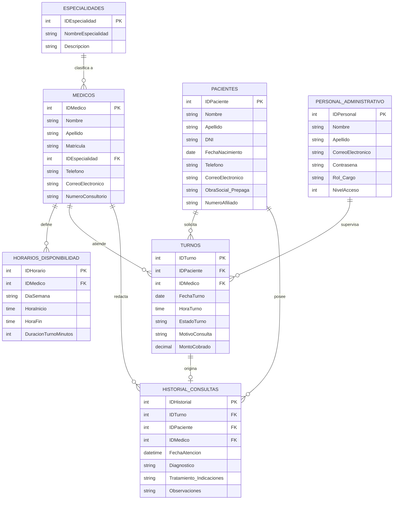

# TRABAJO: DESARROLLO DE SISTEMA - PRIMERA PRESENTACIÓN
**Materia:** Base de Datos 2  
**Proyecto:** Sistema de Gestión y Reservas Clínicas  

---

## 1. Descripción General del Proyecto

El proyecto en cuestión implica el diseño y desarrollo de un **Sistema Integral de Gestión y Reservas Clínicas**, orientado a modernizar y optimizar la administración de citas médicas, mejorar la experiencia tanto de los pacientes como del personal de salud y recepción, y garantizar un registro organizado y seguro de la información médica y operativa de la clínica.

Este sistema se concibe siguiendo una estructura clara y organizada sobre una base de datos relacional, permitiendo una administración eficiente de las agendas médicas, disponibilidad de consultorios, asignación y seguimiento de turnos, y el registro de atenciones y consultas clínicas.

---

## 2. Entidades y Atributos

A continuación se detallan las entidades principales del sistema, sus atributos y la especificación de sus llaves primarias (**PK**) y llaves foráneas (**FK**):

### 1. Pacientes / Usuarios
Representa a los pacientes que solicitan atención médica y gestionan sus citas en el centro clínico.
* **IDPaciente (PK):** Identificador único del paciente (Clave Primaria).
* **Nombre:** Nombre(s) del paciente.
* **Apellido:** Apellido(s) del paciente.
* **DNI:** Documento nacional de identidad único.
* **FechaNacimiento:** Fecha de nacimiento para cálculo de edad y perfil clínico.
* **Telefono:** Teléfono o celular de contacto.
* **CorreoElectronico:** Dirección de correo para envío de notificaciones y recordatorios.
* **ObraSocial_Prepaga:** Denominación de la cobertura de salud o seguro médico.
* **NumeroAfiliado:** Identificador o número de credencial de afiliado.

### 2. Medicos / Profesionales
Contiene la información de los profesionales médicos que prestan servicio en la clínica.
* **IDMedico (PK):** Identificador único del profesional (Clave Primaria).
* **Nombre:** Nombre(s) del médico.
* **Apellido:** Apellido(s) del profesional.
* **Matricula:** Número de matrícula médica profesional única.
* **IDEspecialidad (FK):** Identificador de la especialidad médica que ejerce (Clave Foránea hacia Especialidades).
* **Telefono:** Teléfono institucional de contacto.
* **CorreoElectronico:** Correo institucional del médico.
* **NumeroConsultorio:** Identificador del consultorio físico asignado.

### 3. Especialidades
Catálogo de las diferentes ramas y áreas de la medicina brindadas por la clínica (ej. Cardiología, Pediatría, Traumatología, Dermatología).
* **IDEspecialidad (PK):** Identificador único de la especialidad (Clave Primaria).
* **NombreEspecialidad:** Nombre de la disciplina médica.
* **Descripcion:** Breve descripción del campo de atención.

### 4. Horarios_Disponibilidad (Agenda Médica)
Permite definir los días de la semana y franjas horarias en las que cada profesional brinda atención.
* **IDHorario (PK):** Identificador único del bloque de disponibilidad (Clave Primaria).
* **IDMedico (FK):** Identificador del médico asociado (Clave Foránea hacia Medicos).
* **DiaSemana:** Día de atención semanal (ej. Lunes, Martes).
* **HoraInicio:** Hora en que comienza la atención.
* **HoraFin:** Hora en que culmina la atención.
* **DuracionTurnoMinutos:** Duración promedio por consulta en minutos.

### 5. Turnos / Citas Médicas
Entidad central transaccional que registra la reserva de una cita médica entre un paciente y un profesional.
* **IDTurno (PK):** Identificador único de la reserva/cita (Clave Primaria).
* **IDPaciente (FK):** Identificador del paciente que solicitó el turno (Clave Foránea hacia Pacientes).
* **IDMedico (FK):** Identificador del médico que atenderá la cita (Clave Foránea hacia Medicos).
* **FechaTurno:** Fecha fijada para la cita.
* **HoraTurno:** Hora exacta agendada para la consulta.
* **EstadoTurno:** Estado del turno (Pendiente, Confirmado, En Espera, Atendido, Cancelado, Ausente).
* **MotivoConsulta:** Breve motivo de consulta manifestado por el paciente.
* **MontoCobrado:** Valor de la consulta o copago correspondiente.

### 6. Historial_Consultas (Ficha de Atención)
Registra la evolución o resumen clínico generado una vez que el paciente fue efectivamente atendido.
* **IDHistorial (PK):** Identificador único del registro clínico (Clave Primaria).
* **IDTurno (FK):** Referencia al turno atendido (Clave Foránea hacia Turnos).
* **IDPaciente (FK):** Referencia al paciente evaluado (Clave Foránea hacia Pacientes).
* **IDMedico (FK):** Referencia al médico tratante (Clave Foránea hacia Medicos).
* **FechaAtencion:** Fecha y hora en que se llevó a cabo la consulta.
* **Diagnostico:** Diagnóstico médico determinado.
* **Tratamiento_Indicaciones:** Prescripciones médicas, recetas o estudios solicitados.
* **Observaciones:** Notas clínicas complementarias.

### 7. Personal_Administrativo
Representa al equipo de recepción, secretaría y administradores del sistema.
* **IDPersonal (PK):** Identificador único del usuario administrativo (Clave Primaria).
* **Nombre:** Nombre del personal.
* **Apellido:** Apellido del personal.
* **CorreoElectronico:** Correo institucional de acceso.
* **Contraseña:** Contraseña de acceso al sistema (almacenada de forma segura).
* **Rol_Cargo:** Función desempeñada (Recepcionista, Administrador General, Auditor).
* **NivelAcceso:** Nivel de privilegios y permisos en el sistema.

---

## 3. Actores del Sistema

* **Pacientes / Usuarios:** Interactúan con el sistema buscando médicos por especialidad, reservando turnos disponibles, consultando el estado de sus citas, recibiendo recordatorios y cancelando o reprogramando citas con debida antelación.
* **Médicos / Profesionales:** Visualizan su agenda diaria y semanal de turnos, registran la asistencia del paciente, y cargan los diagnósticos, indicaciones y tratamientos en el historial de consulta.
* **Personal Administrativo / Recepcionistas:** Gestionan turnos de forma presencial o telefónica, recepcionan la llegada de pacientes a sala de espera, validan obras sociales y prepagas, gestionan el cobro de consultas y notifican eventuales cancelaciones.
* **Administrador del Sistema:** Administra las cuentas de usuarios (médicos, secretarios), configura especialidades, asigna consultorios, audita la base de datos y genera reportes estadísticos de atención y rendimiento.

---

## 4. Interacciones y Relaciones

* **Reserva de Citas:** Los pacientes pueden buscar médicos por especialidad, seleccionar un horario libre dentro de la disponibilidad del profesional y confirmar una cita (`Turnos`), vinculando su `IDPaciente` con el `IDMedico`.
* **Organización de Agendas:** Los médicos configuran sus días y horarios de atención (`Horarios_Disponibilidad`), lo que permite al sistema habilitar turnos dinámicamente evitando solapamientos de horarios.
* **Atención y Registro Clínico:** Cuando un turno pasa al estado "Atendido", el médico genera un registro en `Historial_Consultas`, quedando permanentemente vinculado al paciente y al profesional tratante.
* **Gestión de Recepción:** El personal administrativo supervisa en tiempo real la grilla de turnos, confirma asistencias y cobra copagos de acuerdo a la obra social del paciente.
* **Generación de Reportes:** Los administradores emiten reportes analíticos de flujo de pacientes, tasa de ausentismo, nivel de demanda por especialidad y productividad médica.

---

## 5. Alcance del Sistema

El sistema proporcionará una solución completa para la gestión integral de la atención ambulatoria y consultorios externos en centros médicos y clínicas:
* Administración centralizada de pacientes, profesionales de la salud, especialidades y consultorios.
* Configuración flexible de disponibilidades horarias y duraciones de consulta por médico.
* Gestión completa del ciclo de vida del turno (solicitado $\rightarrow$ confirmado $\rightarrow$ en espera $\rightarrow$ atendido / cancelado / ausente).
* Ficha clínica básica de atenciones médicas para seguimiento de pacientes.
* Notificaciones y emisión de comprobantes de turnos.
* Estadísticas y reportes de gestión de citas y tiempos de atención.

---

## 6. Limitaciones

* **Integración con equipamiento hospitalario:** No se conectará de forma directa con sistemas de imágenes diagnósticas ni laboratorios externos (sistemas PACS/DICOM/LIS) en su primera versión.
* **Pasarela de pagos en línea:** En la primera fase no se procesarán pagos electrónicos automáticos bancarios (el registro de cobro y validación de cobertura médica será gestionado por recepción).
* **Conectividad:** Requerirá conexión a la red local de la clínica o internet para sincronizar la base de datos centralizada.
* **Internación y Camas:** El sistema está enfocado exclusivamente en atención ambulatoria y consultorios externos, no incluyendo módulos de internación, quirófanos o guardia de emergencias complejas.

---

## 7. Resumen

En resumen, el **Sistema de Reservas Clínicas** ofrecerá una plataforma integral para modernizar la gestión operativa, optimizar el uso de los consultorios y elevar la calidad de atención al paciente en la clínica. Proporcionará herramientas robustas y confiables para una administración efectiva de los turnos, agendas médicas y registros de consulta, asegurando la consistencia y la integridad de los datos en todo momento.

---

## 8. Diagrama de Entidad-Relación (DER)

### 8.1. Representación Gráfica (Diagrama Mermaid)



---

### 8.2. Esquema Estructural de Bloques (Cuadrícula DER)

```text
+-----------------------+       +------------------------+       +------------------------+
|       Pacientes       |       |        Medicos         |       |         Turnos         |
+-----------------------+       +------------------------+       +------------------------+
| * IDPaciente (PK)     |       | * IDMedico (PK)        |       | * IDTurno (PK)         |
|   Nombre              |       |   Nombre               |       | o IDPaciente (FK)      |
|   Apellido            |       |   Apellido             |       | o IDMedico (FK)        |
|   DNI                 |       |   Matricula            |       |   FechaTurno           |
|   FechaNacimiento     |       | o IDEspecialidad (FK)  |       |   HoraTurno            |
|   Telefono            |       |   Telefono             |       |   EstadoTurno          |
|   CorreoElectronico   |       |   CorreoElectronico    |       |   MotivoConsulta       |
|   ObraSocial_Prepaga  |       |   NumeroConsultorio    |       |   MontoCobrado         |
|   NumeroAfiliado      |       +------------------------+       +------------------------+
+-----------------------+                   |                                |
            |                               |                                |
            |                               v                                v
            |                   +------------------------+       +------------------------+
            |                   | Especialidades         |       | Historial_Consultas    |
            |                   +------------------------+       +------------------------+
            |                   | * IDEspecialidad (PK)  |       | * IDHistorial (PK)     |
            |                   |   NombreEspecialidad   |       | o IDTurno (FK)         |
            |                   |   Descripcion          |       | o IDPaciente (FK)      |
            |                   +------------------------+       | o IDMedico (FK)        |
            |                                                    |   FechaAtencion        |
            |                   +------------------------+       |   Diagnostico          |
            |                   | Horarios_Disponibilidad|       |   Tratamiento_Indicac  |
            |                   +------------------------+       |   Observaciones        |
            |                   | * IDHorario (PK)       |       +------------------------+
            |                   | o IDMedico (FK)        |
            |                   |   DiaSemana            |       +------------------------+
            |                   |   HoraInicio           |       | Personal_Administrativo|
            |                   |   HoraFin              |       +------------------------+
            |                   |   DuracionTurnoMinutos |       | * IDPersonal (PK)      |
            |                   +------------------------+       |   Nombre               |
            |                                                    |   Apellido             |
            +--------------------------------------------------> |   CorreoElectronico    |
                                                                 |   Contraseña           |
                                                                 |   Rol_Cargo            |
                                                                 |   NivelAcceso          |
                                                                 +------------------------+
```

---

### 8.3. Simbología y Convenciones del DER

* **Entidades:** Cada entidad se representa mediante un rectángulo que agrupa su conjunto de atributos.
* **Llaves Primarias (PK):** Resaltadas con un asterisco (`*` o `PK`), como `IDPaciente`, `IDMedico`, `IDEspecialidad`, `IDTurno`, `IDHorario`, `IDHistorial`, `IDPersonal`. Garantizan la unicidad de cada registro.
* **Llaves Foráneas (FK) y Restricciones de Integridad:** Identificadas con (`o` o `FK`), aseguran la integridad referencial:
  * `Turnos.IDPaciente` $\rightarrow$ Clave foránea que referencia a `Pacientes.IDPaciente`.
  * `Turnos.IDMedico` $\rightarrow$ Clave foránea que referencia a `Medicos.IDMedico`.
  * `Medicos.IDEspecialidad` $\rightarrow$ Clave foránea que referencia a `Especialidades.IDEspecialidad`.
  * `Horarios_Disponibilidad.IDMedico` $\rightarrow$ Clave foránea que referencia a `Medicos.IDMedico`.
  * `Historial_Consultas.IDTurno` $\rightarrow$ Clave foránea que referencia a `Turnos.IDTurno`.
* **Cardinalidades del Modelo:**
  * **Especialidades $\rightarrow$ Médicos ($1:N$):** Una especialidad agrupa a uno o varios médicos; cada médico pertenece a una especialidad.
  * **Médicos $\rightarrow$ Horarios ($1:N$):** Un médico posee uno o varios horarios/días de atención programados.
  * **Pacientes $\rightarrow$ Turnos ($1:N$):** Un paciente puede solicitar y registrar múltiples turnos a lo largo del tiempo.
  * **Médicos $\rightarrow$ Turnos ($1:N$):** Un médico atiende múltiples turnos en su agenda.
  * **Turnos $\rightarrow$ Historial de Consultas ($1:1$):** Cada turno completado genera como máximo un único registro clínico de atención.
