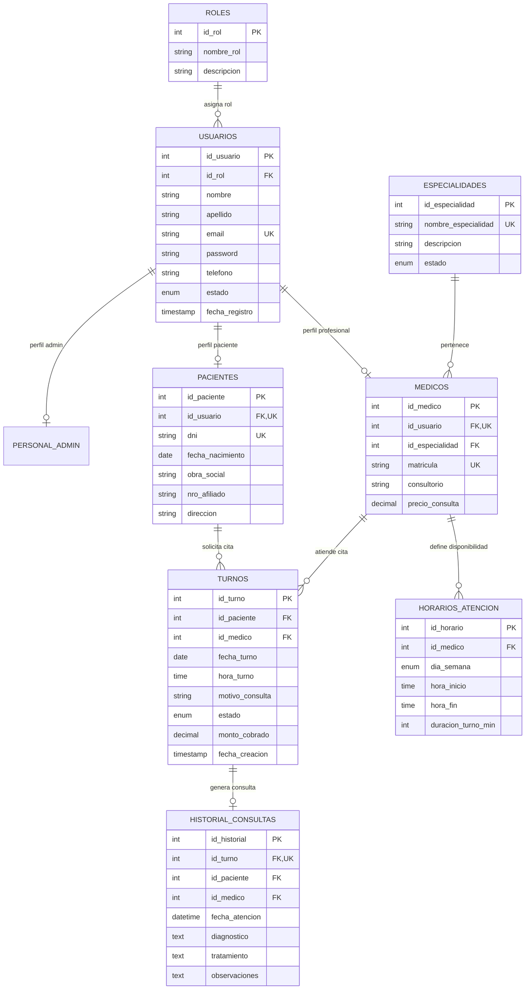

# Plan de Implementación: Sistema de Reservas Clínicas (PHP + MySQL + MVC)

**Materia:** Base de Datos 2  
**Entorno:** XAMPP (Apache + MySQL / MariaDB + PHP 8.x)  
**Arquitectura:** MVC (Modelo - Vista - Controlador)  
**Base de Datos:** Relacional Normalizada (3FN, >4 tablas, Integridad Referencial, Transacciones, Vistas, Triggers y Procedimientos Almacenados)

---

## 1. Descripción del Proyecto

El objetivo es desarrollar un **Sistema Web de Gestión y Reserva de Turnos Clínicos** que permita a pacientes, médicos y personal administrativo gestionar citas médicas sin solapamientos, garantizando la integridad de datos, seguridad de acceso y una experiencia de usuario fluida y moderna.

### Requisitos Técnicos
1. **Backend:** PHP puro estructurado bajo patrón MVC con **PDO** (PHP Data Objects) para acceso seguro y parametrizado a MySQL.
2. **Base de Datos:** MySQL / MariaDB (Motor InnoDB), normalizada en Tercera Forma Normal (3FN), con 8 tablas relacionales, claves foráneas, índices de unicidad para evitar doble asignación de turnos, vistas y procedimientos almacenados.
3. **Frontend:** HTML5, CSS3, JavaScript (Fetch API / AJAX), Bootstrap 5 para diseño responsive moderno, FontAwesome para iconografía y SweetAlert2 para alertas interactivas.
4. **Servidor Local:** Compatible con XAMPP / Laragon / WAMP.

---

## 2. Modelo Relacional de Base de Datos (8 Tablas Normalizadas)

El diseño cuenta con **8 tablas** organizadas para cumplir la 3FN, asegurando que no haya redundancias y manteniendo integridad referencial estricta.



### Detalle de Tablas y Restricciones
1. **`roles`**: Catálogo de roles del sistema (`1: Administrador`, `2: Médico`, `3: Recepcionista/Secretaría`, `4: Paciente`).
2. **`usuarios`**: Entidad base de autenticación y datos personales comunes (email único, contraseña cifrada con `password_hash`).
3. **`especialidades`**: Catálogo de especialidades médicas (Cardiología, Pediatría, Traumatología, etc.).
4. **`medicos`**: Especialización de usuario médico con matrícula profesional única, consultorio y especialidad (`FK`).
5. **`pacientes`**: Especialización de usuario paciente con DNI único, fecha de nacimiento y cobertura médica.
6. **`horarios_atencion`**: Días de atención (`LUNES`, `MARTES`, ...) y rango horario por médico para generar turnos válidos dinámicamente.
7. **`turnos`**: Registro transaccional de citas. Incluye un **Índice Único Compuesto** `(id_medico, fecha_turno, hora_turno)` para impedir a nivel de base de datos que dos pacientes reserven al mismo médico a la misma hora.
8. **`historial_consultas`**: Ficha de atención médica completada por el profesional una vez finalizada la consulta.

---

## 3. Elementos Avanzados de Base de Datos (Base de Datos 2)

Para destacar en la materia se incluirán componentes de lógica en la base de datos:

1. **Vistas SQL (`Views`):**
   * `vw_turnos_detallados`: Une `turnos`, `pacientes`, `medicos`, `usuarios` y `especialidades` para listar agendas de manera óptima sin consultas repetitivas.
   * `vw_agenda_medicos`: Muestra los horarios disponibles de cada profesional agrupados por especialidad.
2. **Procedimientos Almacenados (`Stored Procedures`):**
   * `sp_reservar_turno`: Procedimiento con control transaccional (`START TRANSACTION`, `COMMIT`, `ROLLBACK`) que valida la disponibilidad del médico antes de insertar el turno.
   * `sp_obtener_turnos_disponibles`: Genera y retorna las franjas horarias libres de un médico en una fecha específica según su configuración de `horarios_atencion`.
3. **Disparadores (`Triggers`):**
   * `trg_actualizar_estado_turno`: Al insertarse un registro en `historial_consultas`, actualiza automáticamente el estado del turno en `turnos` a `'ATENDIDO'`.
   * `trg_auditoria_cancelaciones`: Registra en una tabla de log cada vez que un turno es cancelado.

---

## 4. Arquitectura de Software: Patrón MVC en PHP

Estructura modular limpia, sin dependencias externas pesadas, fácil de ejecutar en `htdocs` de XAMPP:

```text
clinica_reservas/
│
├── config/
│   ├── config.php            # Constantes de conexión, URLs y configuración global
│   └── Database.php          # Conexión Singleton con PDO (manejo de transacciones y errores)
│
├── app/
│   ├── Core/
│   │   ├── Controller.php    # Controlador base (renderizado de vistas, respuestas JSON, sesiones)
│   │   ├── Model.php         # Modelo base con operaciones CRUD reutilizables mediante PDO
│   │   └── Router.php        # Enrutador amigable por URL (ej: /turnos/reservar, /medicos/listar)
│   │
│   ├── Models/
│   │   ├── Usuario.php
│   │   ├── Medico.php
│   │   ├── Paciente.php
│   │   ├── Especialidad.php
│   │   ├── Horario.php
│   │   ├── Turno.php
│   │   └── Historial.php
│   │
│   ├── Controllers/
│   │   ├── AuthController.php        # Login, registro de pacientes, logout, control de sesiones
│   │   ├── DashboardController.php   # Panel principal según el rol del usuario
│   │   ├── TurnoController.php       # Reserva de turnos, confirmación, cancelación y calendario
│   │   ├── MedicoController.php      # Gestión de médicos, especialidades y horarios de atención
│   │   ├── PacienteController.php    # Búsqueda y gestión de datos de pacientes
│   │   ├── EspecialidadController.php# CRUD de especialidades médicas
│   │   └── HistorialController.php   # Carga de diagnósticos y fichas clínicas
│   │
│   └── Views/
│       ├── layouts/
│       │   ├── header.php            # Navbar, CDN de Bootstrap 5, FontAwesome
│       │   ├── sidebar.php           # Menú lateral dinámico según rol
│       │   └── footer.php            # Scripts, SweetAlert2, DataTables
│       ├── auth/
│       │   ├── login.php
│       │   └── registro.php
│       ├── dashboard/
│       │   ├── admin.php             # Métricas, totales de turnos, médicos y pacientes
│       │   ├── medico.php            # Agenda del día para el médico
│       │   └── paciente.php          # Mis próximos turnos y solicitudes
│       ├── turnos/
│       │   ├── index.php             # Grilla de turnos con filtros
│       │   ├── reservar.php          # Formulario paso a paso (Especialidad -> Médico -> Fecha -> Hora)
│       │   └── mis_turnos.php        # Vista del paciente
│       ├── medicos/
│       │   ├── index.php
│       │   └── horarios.php          # Configuración de días y horas de atención
│       └── historial/
│           ├── atender.php           # Formulario para cargar diagnóstico y recetas
│           └── ver.php               # Ficha clínica histórica del paciente
│
├── public/
│   ├── index.php             # Punto de entrada único (Front Controller)
│   ├── .htaccess             # Reescribe URLs para enrutamiento limpio
│   └── assets/
│       ├── css/style.css     # Estilos personalizados
│       └── js/
│           ├── main.js       # Validaciones generales y modales
│           └── reservas.js   # AJAX para carga dinámica de médicos y horarios disponibles
│
└── database/
    ├── schema.sql            # Script DDL completo con tablas, PK, FK e índices
    ├── views_procedures.sql  # Vistas, Stored Procedures y Triggers
    └── seeds.sql             # Datos de prueba (médicos, especialidades, usuarios listos para testear)
```

---

## 5. Módulos y Funcionalidades del Sistema

### Módulo 1: Autenticación y Seguridad
* Control de acceso basado en roles (**RBAC**): Administrador, Médico, Recepcionista y Paciente.
* Contraseñas seguras mediante `password_hash()` y `password_verify()`.
* Middleware de verificación de sesión en cada controlador.

### Módulo 2: Gestión de Especialidades y Médicos
* ABM (Alta, Baja, Modificación) de especialidades médicas.
* Registro de médicos con asignación de especialidad, matrícula y consultorio.
* Definición de agenda por médico: selección de días de atención y rango horario (ej. Lunes y Miércoles de 08:00 a 13:00, turnos de 30 min).

### Módulo 3: Motor de Reservas y Turnos Médicos (Flujo Principal)
* **Selector interactivo (AJAX):**
  1. El paciente elige la **Especialidad**.
  2. Se filtran automáticamente los **Médicos** de esa especialidad.
  3. El paciente selecciona una **Fecha**.
  4. El sistema consulta a la base de datos los turnos libres reales para ese día (descartando los ya reservados o fuera de horario).
  5. Se confirma el turno y se emite comprobante en pantalla.
* Prevención estricta de sobreturnos o colisiones de horarios mediante transacciones e índices únicos.

### Módulo 4: Gestión de Atención y Ficha Médica
* El médico visualiza su lista de turnos del día con cambio de estado en vivo (*En Espera*, *En Consulta*, *Atendido*, *Ausente*).
* Al atender, el médico carga el diagnóstico, tratamiento/medicación y observaciones, alimentando la tabla `historial_consultas`.

### Módulo 5: Dashboard y Reportes para Administración
* Cantidad de turnos del día y del mes.
* Tasa de ausentismo vs. turnos completados.
* Especialidades y médicos más demandados.

---

## 6. Plan de Ejecución Paso a Paso

1. **Fase 1: Base de Datos en MySQL (XAMPP)**
   * Creación del script `schema.sql` con las 8 tablas en motor InnoDB con UTF8mb4.
   * Creación de `views_procedures.sql` con vistas, triggers y procedimientos almacenados.
   * Inserción de `seeds.sql` con datos semilla (roles, administrador, especialidades, médicos y horarios).
2. **Fase 2: Núcleo MVC en PHP**
   * Configuración de la conexión PDO (`Database.php`), enrutador (`Router.php`) y controladores/modelos base.
3. **Fase 3: Autenticación y Layouts**
   * Pantalla de login, registro de pacientes y estructura visual responsive (header, sidebar, footer con Bootstrap 5).
4. **Fase 4: Módulo de Médicos, Especialidades y Horarios**
   * CRUDs correspondientes y asignación de disponibilidad horaria por profesional.
5. **Fase 5: Módulo de Turnos y Carga Dinámica AJAX**
   * Formulario de reserva con cálculo de disponibilidad en tiempo real y confirmación de turnos.
6. **Fase 6: Ficha Clínica y Estados de Atención**
   * Pantalla médica para pasar turno a "Atendido" y registrar diagnóstico en el historial.
7. **Fase 7: Pruebas de Integridad, Validación y Documentación**
   * Verificación de restricciones de integridad referencial, pruebas de concurrencia y generación del informe final para la entrega.

---

## 7. Plan de Verificación

### Pruebas de Base de Datos
* **Integridad Referencial:** Intentar eliminar un médico con turnos asociados y verificar que la restricción `ON DELETE RESTRICT` actúe correctamente.
* **Control de Duplicados:** Intentar agendar dos turnos al mismo médico en la misma fecha y hora para validar que el índice compuesto `(id_medico, fecha_turno, hora_turno)` rechace la colisión.
* **Triggers y Vistas:** Comprobar que al insertar en `historial_consultas`, el trigger cambie el turno a `'ATENDIDO'` automáticamente.

### Pruebas Funcionales Web
* **Flujo de Paciente:** Registro $\rightarrow$ Login $\rightarrow$ Reserva de turno $\rightarrow$ Visualización en "Mis Turnos".
* **Flujo de Médico:** Login $\rightarrow$ Ver agenda diaria $\rightarrow$ Atender paciente $\rightarrow$ Guardar diagnóstico.
* **Flujo de Administrador:** Login $\rightarrow$ Crear especialidad $\rightarrow$ Asignar médico $\rightarrow$ Visualizar métricas del dashboard.
